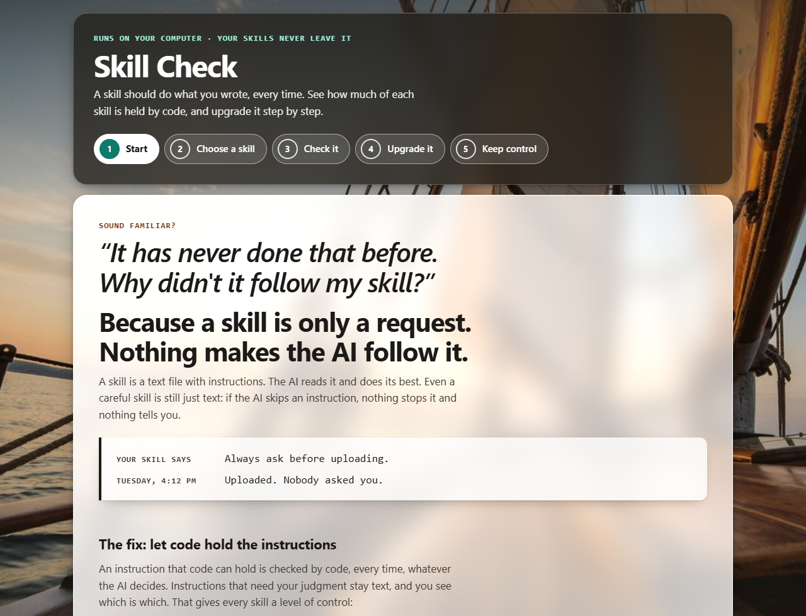
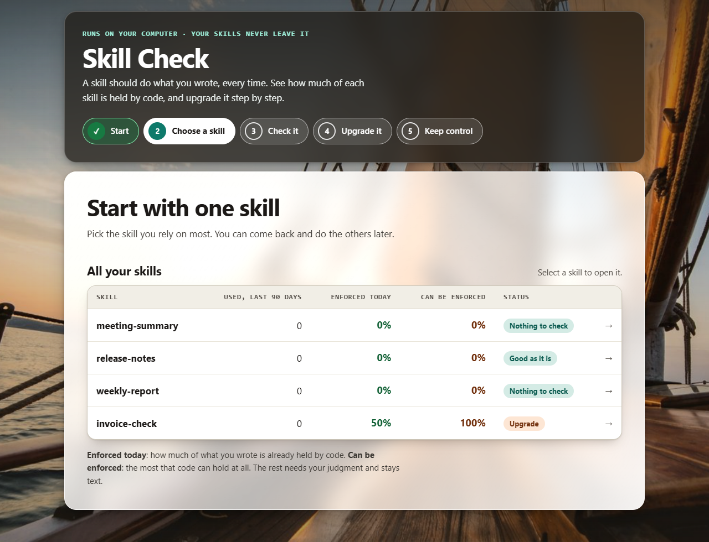
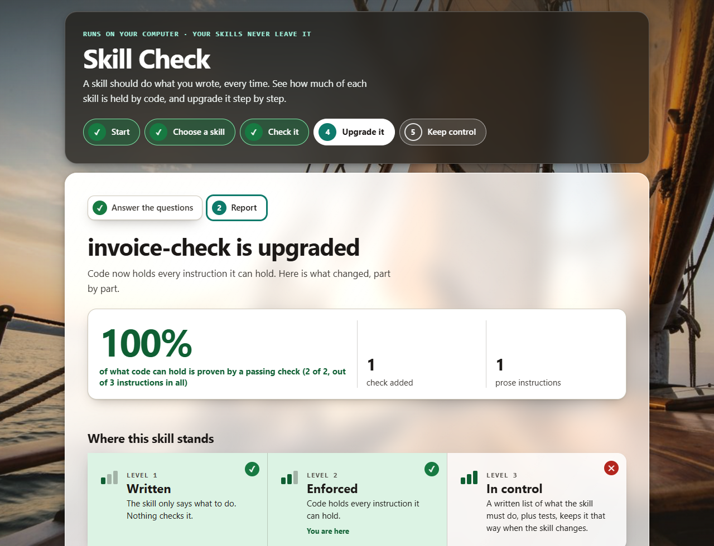

# Skill Check

**Does your Claude skill really do what you wrote? Find out, locally, in a minute.**

A skill is a text file with instructions. Claude reads it and does its best. If it skips an instruction, nothing stops it and nothing tells you. Skill Check looks at every skill on your machine and shows how much of it is held by code and how much is only written down.

Free and open source (MIT). It runs on your computer: no account, no upload, no network.



## What you get

- **A level for every skill.** Level 1 Written (only text), Level 2 Enforced (code holds every instruction it can hold), Level 3 In control (an agreed list that is re-checked after every change).
- **The share that code could hold.** For each skill: how much is enforced today, and how much could be enforced at all. The rest needs your judgment and stays text.
- **Your most used skills first.** It reads how often you used each skill in the last 90 days and suggests where to start.
- **Authoring limits.** Size, name and description rules, backslash paths, references that link on to other references. Hard findings break a limit, recommended ones are advice.
- **Look-alike descriptions.** Skills whose descriptions use very similar words, so Claude may pick the wrong one.
- **Skills from plugins are marked** "From a plugin" and are never changed. A plugin update would replace the change.



## Install

In Claude Code:

```
/plugin marketplace add svenroth-ai/skill-check
/plugin install skill-check@skill-check
```

Restart Claude Code, then run `/skill-check`. The view opens beside the chat, or at `http://localhost:3921` in your browser.

**Needs** Python 3.10 or newer, or [uv](https://docs.astral.sh/uv/) if you have no Python. No packages. Tested on Windows. macOS and Linux should work the same way; reports are welcome.

## Next step: Skill Upgrade

Skill Check shows where you stand. **Skill Upgrade** is the paid next step: it writes the checks for you, asks only what it cannot work out, shows the proof, and can keep a skill in control. The offer and the buy page are inside Skill Check, on the fourth step.



## Privacy and security

- Everything stays in `~/.shipwright/skill-check/` on your machine. Nothing is sent anywhere.
- The view binds to `127.0.0.1` only and refuses requests whose Host header is not `localhost` or `127.0.0.1`.
- Skill Check only reads your skills. It never changes one.

## Use the scripts directly

```
python scripts/check_skills.py --root ~/.claude/skills    # scan, prints a summary
python scripts/check_skills.py --json                     # the full result as JSON
python scripts/serve.py --port 3921                       # the local view
```

## Develop

```
python -m unittest discover -s tests
```

The authoring limits come from `config/conventions.skill_authoring.json`. See [CONTRIBUTING.md](CONTRIBUTING.md) if you want to help.

## Part of Shipwright

Skill Check is from the same author as [Shipwright](https://github.com/svenroth-ai/shipwright), an open-source harness that wraps the whole software lifecycle around Claude Code.

## License

MIT, see [LICENSE](LICENSE).
